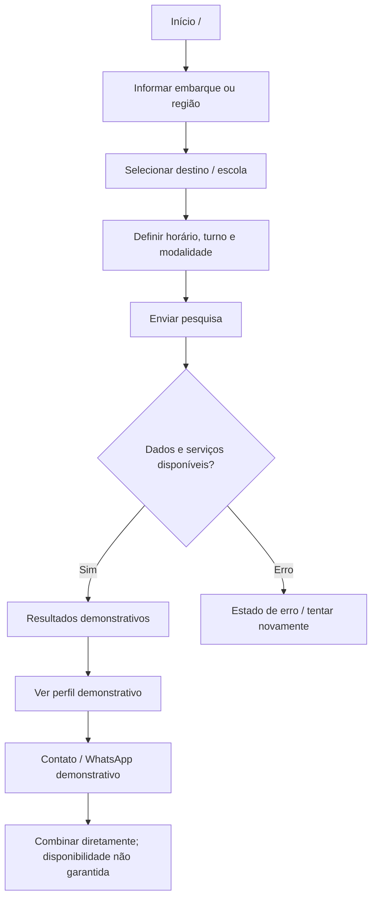
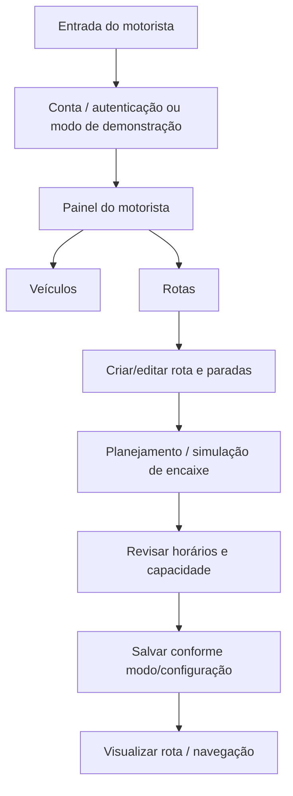

# Fluxo e wireframes documentais

Estes diagramas são documentação estática, não novos componentes de interface. O fluxo abaixo resume as rotas/jornadas localizadas em `src/App.tsx`, `src/components/search/SearchForm.tsx`, `src/pages/SearchResultsPage.tsx`, `src/features/family-search-demo/FamilyDemoResults.tsx` e no painel do motorista. Os wireframes são de baixa fidelidade e representam a estrutura/jornada, não uma especificação pixel-perfect nem prova de teste com usuários.

## User flow — família (busca demonstrativa)



A interface pode recorrer a serviços externos para localizar endereços/rotas. A busca demonstrativa não confirma vaga nem cria uma reserva real. Se a consulta de dados Supabase falha quando configurado, `VitrineProvider` marca erro; não se deve descrever isso como fallback silencioso.

## User flow — motorista (sintético)



O código contém múltiplas áreas e níveis de implementação. O modo de demonstração de motorista pode usar armazenamento local e não equivale à conta/serviço operacional. Evidência: `src/pages/motorista/`, `src/data/motorista-store.ts`, `src/lib/supabase.ts`.

## Wireframe 1 — pesquisa da família

```text
┌──────────────────────────────────┐
│ VanBora                 [Menu]   │
│ Encontre transporte escolar      │
├──────────────────────────────────┤
│ Embarque / bairro                │
│ [____________________________]   │
│ Escola ou destino                │
│ [____________________________]   │
│ Horário / turno                  │
│ [___________]   ( ) Ida ( ) Volta│
│ Contratação: [Mensal] [Avulso]   │
│                                  │
│ [       Buscar opções       ]    │
│ Dados demonstrativos identificados│
└──────────────────────────────────┘
```

## Wireframe 2 — resultados

```text
┌──────────────────────────────────┐
│ [←] Resultados da busca          │
│ Critérios resumidos / [Editar]   │
├──────────────────────────────────┤
│ DEMONSTRAÇÃO                     │
│ Perfil fictício · veículo        │
│ região / horário informado      │
│ R$ exemplo · vagas exemplo       │
│ [Ver perfil]                     │
├──────────────────────────────────┤
│ DEMONSTRAÇÃO                     │
│ Outra opção fictícia             │
│ [Ver perfil]                     │
│                                  │
│ Valores e disponibilidade não reais│
└──────────────────────────────────┘
```

## Wireframe 3 — organização de rota do motorista

```text
┌──────────────────────────────────┐
│ Painel do motorista              │
│ [Resumo] [Veículos] [Rotas]      │
├──────────────────────────────────┤
│ Minhas rotas                     │
│ [ + Criar rota ]                 │
│                                  │
│ Rota · turno · estado            │
│ Paradas: origem → embarques →    │
│ destino                          │
│ [Editar] [Planejar] [Mapa]       │
│                                  │
│ Cenário de demonstração, se ativo│
└──────────────────────────────────┘
```

## Confirmação necessária

A equipe deve revisar se estes esquemas correspondem ao fluxo que pretende demonstrar em 09/11, especialmente qual caminho será usado no palco e quais páginas funcionam sem credenciais/configuração externa. Não foram criados screenshots, nem foi alegado teste de usabilidade.
