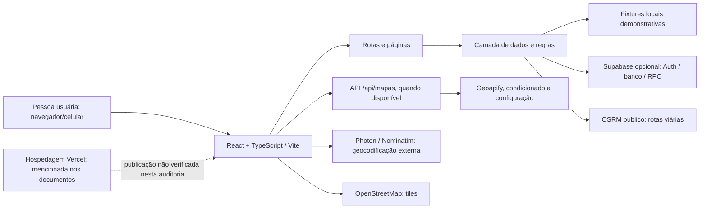

# Arquitetura, dados e recursos

## Diagrama de arquitetura (visão documental)

**Evidências:** `package.json`; `src/App.tsx`; `src/data/source.ts`; `src/data/VitrineProvider.tsx`; `src/lib/supabase.ts`; `src/lib/geocode.ts`; `api/mapas.ts`; componentes `src/components/motorista/MapaInterativoRota.tsx` e `src/features/family-search-demo/FamilyDemoResults.tsx`; `vite.config.ts` para PWA. A presença de código de integração não comprova disponibilidade/credenciais do ambiente de demonstração.

## Stack e justificativa documental

| Tecnologia/serviço | Evidência no repositório | Uso descrito com cautela |
|---|---|---|
| React 18 + TypeScript | `package.json`, `src/` | UI por componentes e lógica tipada. |
| Vite | `package.json`, `vite.config.ts` | Desenvolvimento/build; scripts disponíveis no manifesto. |
| Tailwind CSS | dependência e configurações do projeto | Estilização utilitária. |
| React Router | `react-router-dom`, `src/App.tsx` | Rotas cliente. |
| Supabase JS | `@supabase/supabase-js`, `src/lib/supabase.ts`, `src/data/source.ts` | Banco/Auth/RPC condicionais; modo de demonstração local também existe. Não declarar serviço online validado nesta auditoria. |
| Leaflet | `leaflet`, componentes de mapa | Renderização de mapas em telas. |
| OpenStreetMap, OSRM, Photon/Nominatim, Geoapify | URLs e chamadas em `src/lib/geocode.ts`, `api/mapas.ts` e componentes | Tiles, geocodificação/matriz/rota; dependem de rede/provedor e, para caminhos Geoapify, de configuração. OSRM público não tem SLA garantido pelo projeto. |
| Vite PWA | `vite-plugin-pwa`, `vite.config.ts` | Manifest/cache do app shell; não significa que app foi instalado em qualquer dispositivo. |
| Vercel | `vercel.json` (se presente) e menções nos docs | Hospedagem descrita como ferramenta; deploy público atual não foi verificado nesta tarefa. |

## Fontes de dados: real, demonstrativo e não verificado

- **Motoristas, preços, vagas e perfis da busca:** `src/data/motoristas.ts` marca os registros como demonstração, com campos demonstrativos e telefones fictícios; `src/features/family-search-demo/` e `src/features/family-search-demo/avaliacoes-demo.ts` também declaram avaliações/dados demo. Não são ofertas reais.
- **Cenário do motorista:** `src/data/motorista-demo.ts` descreve dados e coordenadas aproximadas como demonstrativos e informa que não são dados reais de crianças. Tratar todos os números/nomes como ficção de exemplo.
- **Destinos:** `src/data/destinos.ts` inclui URLs de fonte por registro e descreve destinos como reais, com coordenadas obtidas por geocodificação. Esta auditoria confirma a existência dessas declarações no código, não a correção/atualidade de cada endereço ou coordenada nem validação independente das fontes.
- **Geocodificação e rotas:** chamadas a Photon, Nominatim, Geoapify, OSRM e tiles OSM aparecem em código. São serviços externos, sujeitos a disponibilidade, limites e termos próprios. Tempos são estimativas, não garantia operacional.
- **Persistência operacional:** `src/data/source.ts`, `src/data/motorista-store.ts` e `src/lib/supabase.ts` mostram caminhos de banco e demonstração/local; configuração e disponibilidade do projeto em produção não foram certificadas aqui.
- **Dados de pesquisa de campo:** não localizados como resultados concluídos nos READMEs de `docs/pesquisas/`; pastas consultadas continuam marcadas “a iniciar”.

## Bibliotecas, templates e ativos

Dependências diretas verificadas em `package.json`: `@fontsource/inter`, `@fontsource/plus-jakarta-sans`, `@phosphor-icons/react`, `@supabase/supabase-js`, `leaflet`, `lucide-react`, `framer-motion`, `react`, `react-dom`, `react-easy-crop`, `react-router-dom`, `clsx`, `tailwind-merge`; ferramentas de desenvolvimento incluem Vite, plugin React, TypeScript, Tailwind, PostCSS, Vitest e Sharp. É um inventário de manifesto, não uma revisão de todas as licenças nem uma lista exaustiva de recursos externos.

Não foi localizada evidência verificável suficiente para atribuir template externo específico, imagens geradas por ferramenta específica, nem origem/licença de cada ativo visual. O repositório inclui ativos em `public/` e `src/assets/`; a equipe deve complementar origem/autoria/licenças antes de declarar lista definitiva. Não identificar nomes/fotos de demonstração como pessoas reais.
